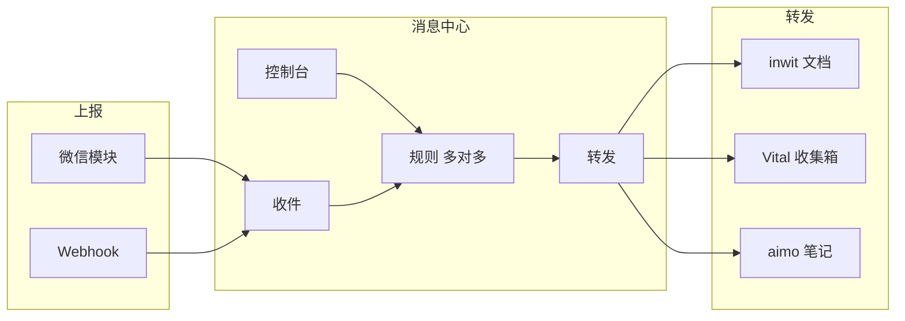

# 消息中心方案：多渠道收发

| 项 | 值 |
| --- | --- |
| 状态 | 已确认，按此开工 |
| 日期 | 2026-11-22 |
| 需求 | [prd.md](prd.md) |
| 选型来源 | `~/project/mygithub/inwit` 的服务端、登录和令牌做法。不搬学习业务，不共用库 |

账号密钥不按上报渠道拆开。一把 `mck_` 可以由用户放到微信、Webhook，或两处复用。密钥有名称和备注。目的地令牌仍按连接保存，因为那是 inwit、Vital、aimo 各自签发的。

## 结论

消息中心是一个独立的小服务。网页管账号、上报凭证、目的地连接和规则。微信模块和 Webhook 只上报。转发在服务端异步完成。

收发都是渠道，而且多对多。

| | 这一期 | 以后 |
| --- | --- | --- |
| 上报 | 微信、Webhook | 再加一种上报适配器 |
| 转发 | inwit、Vital、aimo | 再加一种转发适配器 |

一条内部消息可以被多条规则命中，每条规则产生一条投递。多个 App Key、多个 Webhook 共用这个用户的规则。



技术形状对齐 inwit：pnpm、Node 22、Fastify、Drizzle、PostgreSQL、Zod DTO、Vite、React、`@rabjs/react`。登录是邮箱密码（argon2id）加可选的 Keycloak 授权码。业务接口只认消息中心自己的会话。目的地令牌加密存在消息中心，不进 APK。

本地开发端口避开 inwit（API `3020`、网页 `5190`）：

| 进程 | 端口 |
| --- | --- |
| API | `3030` |
| 网页 | `5191` |

生产域名这一期不先定。网页 origin 用 `WEB_ORIGIN`，必须和浏览器地址精确一致，否则不会种登录 cookie。

数据库示例地址是 `192.0.2.1:25432`，和 inwit 同一台 PostgreSQL。三个库、三个属主，应用不使用超级用户连接：

| 用途 | 库 | 属主 |
| --- | --- | --- |
| 开发 | `message_center_dev` | `message_center_dev_user` |
| 测试 | `message_center_test` | `message_center_test_user` |
| 生产 | `message_center_prod` | `message_center_prod_user` |

口令只放本机环境文件，不进 git。测试在 `message_center_test` 里每次建独立 schema，跑完删除，不碰开发和生产库。

## 仓库形状

```text
apps/server     Fastify 5、Drizzle、PostgreSQL
apps/web        Vite、React 19、@rabjs/react
packages/dto    Zod。渠道标识和 HTTP 形状先改这里
```

不引入 Qdrant、Meilisearch，也不为这一期引入 Redis。数据库是消息中心自己的库。迁移用 Drizzle 生成。

环境变量不进 git：`JWT_SECRET`、`COOKIE_SECRET`、`SECRET_ENCRYPTION_KEY`（64 位 hex）、数据库口令、OIDC client secret。

渠道标识放在 dto 里，用字符串枚举，不散落在 if 里：

```text
ingress:  wechat | webhook
egress:   inwit | vital | aimo
```

新增渠道时加一个枚举值和一个适配器。规则表不按渠道拆表。

## 登录

与 inwit 同一条最小路径。

| 接口 | 作用 |
| --- | --- |
| `POST /api/auth/register` | 邮箱 + 至少 8 位密码 |
| `POST /api/auth/login` | 同上 |
| `POST /api/auth/refresh` | 换发访问令牌 |
| `POST /api/auth/logout` | 会话版本加一，清 cookie |
| `GET /api/auth/me` | 当前用户 |

密码 argon2id。访问令牌是 HMAC JWT，默认 15 分钟，载荷含用户 id、类型、`sessionVersion`。刷新令牌默认 30 天。退出时 `users.session_version` 加一，旧会话失效。

Cookie 名 `mc_at`、`mc_rt`。`httpOnly`、`SameSite=Lax`、签名、`path=/`。生产环境 `secure`。`Origin` 精确等于 `WEB_ORIGIN` 时种 cookie，否则把两枚令牌放进 JSON。管理接口接受 Bearer 访问 JWT，没有时再读 cookie。

错误体：`{ "error": { "code", "message" } }`。

每个用户一行。钥匙、Webhook、连接、规则、消息都带 `user_id`。一次浏览器会话只有一个用户。

统一账号的主键是 `(issuer, sub)`。运行时不用邮箱合并已有密码账号。密码哈希允许为空。

IdP 用 inwit 已经在用的 Keycloak。一次部署只连一个 realm。

| 环境 | issuer |
| --- | --- |
| 生产 | `https://super-agent-auth.aimo.plus/realms/aimo-plus-prod` |
| 测试 | `https://super-agent-auth.aimo.plus/realms/aimo-plus-test` |

消息中心使用自己的 confidential client，建议 client id 为 `message-center`，audience 为 `message-center-api`。不复用 `inwit`、`super-agent-native`，audience 也不用 `inwit-api` 或 `super-agent-api`。Keycloak 的 access token 不能调用消息中心的业务接口。登录成功后仍签发 `mc_at` / `mc_rt`。

环境变量与 inwit 同名同语义，缺任何一项则整条能力关闭：`OIDC_ISSUER`、`OIDC_CLIENT_ID`、`OIDC_CLIENT_SECRET`、`OIDC_REDIRECT_URI`、`OIDC_AUDIENCE`。可选 `OIDC_SCOPES`，默认 `openid profile email`。

浏览器流程与 inwit 相同：`GET /api/auth/oidc/status` 不访问 Keycloak；`start` 写 10 分钟的 httpOnly cookie（state、nonce、PKCE verifier）后 302；`callback` 用 `client_secret_post` 换票，校验 audience，按 `(issuer, sub)` 找到或创建本地用户。授权码加 PKCE S256。不做密码模式、implicit、登出联动、解绑、补设本地密码。

## 上报凭证

账号下一套密钥，不按渠道分表，也不分成两种前缀。目的地令牌不是这种密钥。

| | 账号密钥 |
| --- | --- |
| 前缀 | `mck_` |
| 谁持有 | 用户自己决定：微信模块、Webhook 调用方，或两边同一把 |
| 能调用 | `POST /api/v1/ingest/wechat` 和 `POST /api/v1/ingest/webhook` |
| 备注 | 用户填写，只用于辨认，不参与鉴权或匹配 |
| 是否绑定 wxid 或渠道 | 否 |

生成方式对齐 inwit 的 access token 存法，权限单独收窄：明文在创建响应里完整出现，并 AES-256-GCM 加密落库，便于登录后再次显示。查找用 SHA-256。列表返回名称、备注、预览（前 8 位和后 4 位）。每用户未吊销密钥最多 20 把。

吊销后哈希对不上，两个上报接口都返回 401，错误码 `INVALID_APP_KEY`。不影响网页会话，也不影响同一用户的其它密钥。

模块打包配置只留这两项。缺任一，或地址不是无路径的 https origin，则不上报，Hook 照常安装。

```properties
MESSAGE_CENTER_URL=https://message-center.example
MESSAGE_CENTER_APP_KEY=mck_...
```

## 内部消息

两种上报先收成同一种消息，规则只看这一种。

| 字段 | 微信 | Webhook |
| --- | --- | --- |
| `ingress` | `wechat` | `webhook` |
| `sender` | 群前缀，或单聊的 `fromUser` / `talker` | 调用方给的字符串 |
| `room` | `talker` 以 `@chatroom` 结尾时用它，否则空 | 调用方可空 |
| `kind` | `text`、`link`、`image`、`voice` | 同左 |
| `body` | 拆掉群前缀后的文本；链接是 XML 里的标题和 URL | 调用方给的文本或 URL |
| `dedup_key` | 见下 | 该 Webhook 的 `eventId` |

微信群前缀算法与模块里的 `GroupMessage.parse` 相同，只在消息中心实现一份。

微信去重键按用户隔离。`msgSvrId > 0` 时原文是换行拼接的 `wechat/v1`、talker、十进制 type、十进制 msgSvrId。否则把最后一段换成 `ct={createTime}` 和原文的 SHA-256。模块仍保留 10 分钟进程内去重，只为少打重复请求。权威去重是 `(user_id, dedup_key)`。

Webhook 的 `eventId` 在该用户下唯一。调用方不传则 400。同一把或另一把密钥再次带上同一个 `eventId`，都视为这一用户的重复上报。

图片和语音可以入库，`kind` 分别为 `image` 和 `voice`，没有文件字节。视频和表情直接 400，不落库。`isSend != 0` 的微信请求 400。正常模块不会发出这种请求。

## 上报接口

### 微信

```http
POST /api/v1/ingest/wechat
Authorization: Bearer mck_...
```

```json
{
  "moduleBuild": "1.8-8076-20261005",
  "type": 1,
  "isSend": 0,
  "talker": "wxid_or_room",
  "fromUser": "wxid_or_room",
  "content": "原文，群消息可带发送者前缀",
  "msgSvrId": 0,
  "createTime": 0
}
```

正文上限 64 KiB。重复键返回 200 和已有消息，不新增加投递。新消息 202。响应里没有目的地的写入结果。

### Webhook

```http
POST /api/v1/ingest/webhook
Authorization: Bearer mck_...
```

与微信上报接受同一套密钥。

```json
{
  "eventId": "caller-defined-id",
  "kind": "text",
  "sender": "alice",
  "room": "optional-room",
  "text": "正文",
  "url": null,
  "title": null
}
```

`kind=link` 时要有 `url`。`text` 与链接的 `title` 至少有一个非空。`kind` 为 `image` 或 `voice` 时不接受文件，只记录类型。

## 规则

`forward_rules`：用户、名称、启用、`exclusive`、可选 `match_ingress`、可选 `match_room`、可选 `match_sender`、目的地连接 id。

命中：

1. 取出该用户全部启用规则。
2. 填了上报渠道的，必须等于消息的 `ingress`。
3. 填了房间的，必须等于 `room`。
4. 填了发送者的，必须等于 `sender`。
5. 全部命中的规则各产生一条投递。
6. 若其中至少一条 `exclusive` 为真，丢掉非独占的命中。剩下的独占规则都投。

没有优先级数字。多对多不靠「第一条赢」。要保住现在那个群只进 aimo，就把该房间的 aimo 规则标成独占。

同一条消息对同一个连接只产生一条投递。两条规则指向同一连接时，留一条即可。

## 目的地连接

一张 `connections` 表，用 `provider` 区分三个渠道。不拆成三张令牌表。

字段：用户、显示名、`provider`、API origin、令牌密文、令牌预览、对方用户 id、对方显示名、状态、`allow_image`、`allow_voice`。后两个默认 false。

保存前检查 origin 是 https 且没有路径，令牌前缀与渠道一致，然后：

| provider | 前缀 | 校验 |
| --- | --- | --- |
| `vital` | `vt_` | `GET {origin}/api/v1/auth/me`，默认 origin `https://vital.aimo.plus` |
| `aimo` | `aimo_tk_` | `GET {origin}/api/v1/user/info`，默认 origin `https://aimo.plus` |
| `inwit` | `iwt_` | `GET {origin}/api/auth/me`，默认 origin `https://inwit.aimo.plus` |

对方拒绝或前缀不对，不插入。密文用 `SECRET_ENCRYPTION_KEY` 做 AES-256-GCM，格式对齐 inwit 的 `v1:` 前缀。接口不返回明文。

状态 `active` 或 `unauthorized`。某一条投递收到 401 时，只把这一行改成 `unauthorized`，之后不再使用，直到用户换令牌并重新校验。

## 转发适配器

worker 轮询到期投递，不引入 Redis。一条消息的多条投递互相独立。文本和链接才会真正发 HTTP。

### Vital

行为从模块的 `InboxPayloadMapper` 搬过来。

- 文本：`POST /api/v1/inbox`，`source` 为 `wechat`（Webhook 来的用 `manual`，因为 Vital 的枚举里没有 webhook）。标题是正文第一行，markdown 是正文。`siteName` 为「微信」或「Webhook」。群的 `byline` 是 `{发送者} · {房间}`。
- 文本带幂等头，值是消息去重原文的 SHA-256。
- 合法链接先 `POST /api/v1/inbox/extract-jobs`，间隔 2 秒，最多 45 次。成功后创建，不另送幂等头。失败则标题加原链接，仍带 `originalUrl`。
- 超时：JSON 连接 8 秒、读取 15 秒；extract 读取 20 秒。这些等待在 worker 里。

Webhook 写入 Vital 时 `source` 不用 `wechat`，避免收集箱把外部 HTTP 显示成微信收藏。

### aimo

与模块今天的个人令牌路径一致，不走 `/api/v1/memos/ba/create`。

- 先 `GET /api/v1/categories`，按名字找「微信收集」，没有则 `POST /api/v1/categories`。
- `POST /api/v1/memos`，`type=text`。普通文本放 `content`。链接用标题做 `content`，URL 做 `source`。
- 成功是 HTTP 2xx 且 JSON `code == 0`。记录 `data.memo.memoId`。
- aimo 没有与 Vital 对等的幂等头。投递行在发出前就是唯一的；worker 只有还没成功过的行才会 POST。进程在对方已成功、本地还没记下 memoId 时可能再写一条，这一期接受这个窗口。

### inwit

用个人访问令牌调用已经存在的开放创建接口，不走浏览器会话。

- `POST {origin}/api/open/documents`
- 正文是 `markdown`，不要同时传 `html`。
- `title` 用第一行或链接标题，截到 500。
- 链接另传 `sourceUrl`。
- 不传 `topicId`。
- 成功记下返回的文档 id。
- 幂等同样靠投递行，不靠 inwit 再去重。

### 图片和语音

投递生成时就看连接上的开关，不进 worker 的发送函数。

| 开关 | 投递状态 |
| --- | --- |
| 关 | `skipped`，原因 `media_disabled` |
| 开 | `skipped`，原因 `media_transport_pending` |

第二种是留给 S3 转存模块的。那一模块做的时候，把 `media_transport_pending` 的行改成真正上传，连接开关不用迁移。这一期没有字节，也没有 S3 客户端。

## 数据

```text
users
  id, email 唯一, password_hash 可空, display_name, session_version

oidc_identities
  user_id, issuer, sub
  唯一 (issuer, sub)
  唯一 (user_id, issuer)

api_keys
  id, user_id, name, note, token_hash 唯一, token_encrypted, token_preview,
  last_used_at, revoked_at

connections
  id, user_id, provider, label, api_base,
  token_encrypted, token_preview,
  remote_user_id, remote_display_name, status,
  allow_image, allow_voice

forward_rules
  id, user_id, name, enabled, exclusive,
  match_ingress 可空, match_room 可空, match_sender 可空,
  connection_id

inbound_messages
  id, user_id, ingress, api_key_id, dedup_key,
  sender, room, kind, body, raw_ref, created_at
  唯一 (user_id, dedup_key)

deliveries
  id, message_id, rule_id, connection_id,
  status, skip_reason, attempts, next_attempt_at,
  remote_id, http_status, error_code
  唯一 (message_id, connection_id)
```

`deliveries.status`：`queued`、`delivered`、`skipped`、`failed`。消息本身不再挤成一个总状态。没有投递就是未匹配。控制台按投递列出结果。

正文留在 `inbound_messages`。列表默认不返回正文，点开才取。这一期不设保留期。

## 控制台

状态放 `@rabjs/react` 的 Service 里，组件不直接 `fetch`。

| 页面 | 内容 |
| --- | --- |
| 登录 | 邮箱密码。OIDC 启用时多一个「使用统一账号登录」 |
| 接入 | 密钥的创建、备注、再次显示、吊销 |
| 连接 | 三个渠道、对方账号、图片开关、语音开关、失效状态 |
| 规则 | 上报渠道、房间、发送者、连接、独占 |
| 消息 | 来源、发送者、房间、类型，以及每条投递的结果 |

按桌面宽度使用。

## 失败与重试

JSON 调用的连接 8 秒、读取 15 秒。IO 错误和 502/503/504 最多再试 3 次，间隔 30 秒、2 分钟、10 分钟。401 把该连接标为 `unauthorized` 并停止这一条。其它 4xx 标失败，不重试。

日志只记凭证 id、渠道、状态、发送者、房间、`error.code`。不记 Authorization，不记正文，不记对方 `details`。

## 实现顺序

1. **账号。** 注册、登录、退出、统一账号开关。
2. **上报。** 账号密钥、微信与 Webhook 两个入口、落库、去重。没有规则时消息是未匹配。图片和语音能入库。
3. **三种连接、规则、worker。** 文本和链接能写入 inwit、Vital、aimo。独占生效。媒体开关能保存，打开后的投递是等待转存。
4. **微信模块，在 WechatMsgHook 仓库。** 删掉目的地客户端和本地策略，改成上报。版本号三处一起抬。

第 4 步完成前，现有模块继续按 APK 里的策略工作。切换当天停用旧包，再启用只上报的新包，避免同一条消息被旧包和新中心各写一次。

## 安全

| 风险 | 处理 |
| --- | --- |
| APK 或 Webhook 配置里的账号密钥被读出 | 只能上报，不能改规则或读目的地令牌。吊销即时生效。三种目的地令牌都不在调用方 |
| 同一把密钥两处复用 | 允许。泄露后吊销这一把，另一把不受影响 |
| 日志带出令牌或正文 | 不记 Authorization、正文和对方 `details` |
| 钥匙串用户 | 凭证只进入它所属用户的库，请求体不能指定别人的 `user_id` |
| 统一账号误合并 | 只认 `(issuer, sub)` |
| 半套 OIDC 配置 | 缺一项就整能力关闭 |
| 明文 HTTP | 模块地址和三个 origin 都只接受 https origin |

## 测试

Vitest，不连真实的 Keycloak 和三个目的地：

- 退出后旧 JWT 失效。OIDC 缺一项时 status 为关闭。`(issuer, sub)` 二次登录是同一用户，邮箱相同但 sub 不同则不是。
- 账号密钥能上报微信，也能上报 Webhook。吊销后两个入口都 401，且不能调用规则接口。备注不参与鉴权。
- 同一微信去重键第二次为 200，不新增投递。同一用户的 Webhook `eventId` 同样，换一把密钥也不新增。
- 群前缀拆分与现在的 `GroupMessage` 一致。
- 两条规则指向 Vital 和 inwit 时产生两条投递。指向同一连接的两条规则只产生一条。
- 独占规则命中时，非独占规则不产生投递。两条独占都产生。
- 图片在开关关闭时是 `media_disabled`，打开时是 `media_transport_pending`，两种都不出现出站 HTTP。
- Vital 文本的幂等头是约定原文的 SHA-256。带 `originalUrl` 的创建不带这个头。
- 401 只把对应连接标成 `unauthorized`。

真机 Hook、三个目的地里的实际页面，放在第 4 步的设备验收里做。
